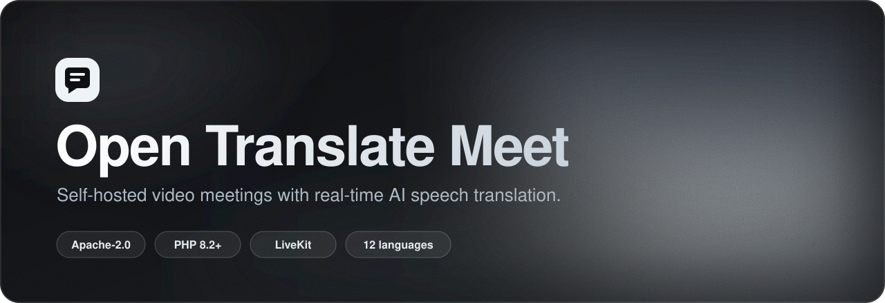
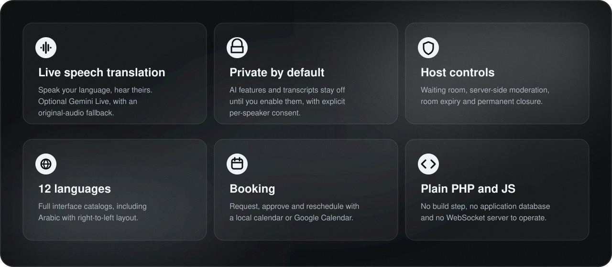
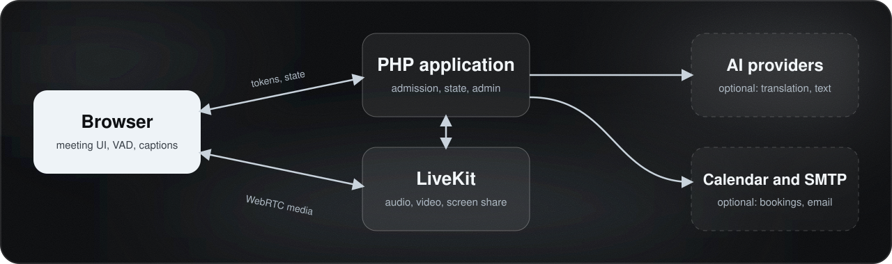

<div align="center">



<br>

**English** · [Türkçe](README.tr.md)

<br>

[](LICENSE)
[](https://github.com/emreocell/Open-Translate-Meet/actions/workflows/quality.yml)
[](composer.json)
[](https://livekit.io)
[](assets/i18n)

[Quick start](#quick-start) · [Features](#features) · [Architecture](#architecture) · [Integrations](#integrations) · [Documentation](#documentation) · [Contributing](#contributing)

</div>

<br>

**Open Translate Meet** is a self-hosted video meeting application with optional real-time speech translation. It is built with plain PHP, browser JavaScript and [LiveKit](https://livekit.io), and ships with a standalone administrator interface. No proprietary management panel, application WebSocket server or application database is required.

You control the branding, credentials, meeting policies and data retention. **AI features and persistent transcripts are disabled by default.**

<br>

## Features



- **Meetings:** video, microphone, screen sharing, device selection, chat and bounded image/video attachments.
- **Access control:** separate participant invitations and private host capabilities, server-side moderation, waiting-room admission, room expiration and permanent closure.
- **Speech translation (optional):** Gemini Live translation, in-meeting speaking/listening language changes, reconnection status and an original-audio fallback.
- **Chat translation (optional):** Gemini or any OpenAI-compatible text endpoint. The original message always stays available.
- **Transcripts and summaries (optional):** per-speaker consent, a separate consent for AI summaries, JSON/text export and evidence-linked draft summaries.
- **Booking (optional):** requests, approval, cancellation and rescheduling with local availability or Google Calendar, plus configurable SMTP notifications.
- **Administration:** room and booking management, provider status and usage counters. Browser-reported audio and operator-rate estimates are clearly distinguished from provider billing.

<br>

## Architecture



LiveKit carries the media and the PHP application controls admission and retained state. A configured Gemini project receives the audio of each translating speaker. Text and summary providers receive only the content needed for the requested feature. See the [data-flow and privacy guide](docs/PRIVACY.md).

<br>

## Quick start

**Requirements**

- PHP **8.2+** with `curl`, `fileinfo`, `gd`, `mbstring`, `openssl` and `session`
- Composer 2
- HTTPS for real browser media
- LiveKit Cloud or a self-hosted LiveKit server
- FFmpeg and FFprobe (only for video attachments)

**Install**

```sh
git clone https://github.com/emreocell/Open-Translate-Meet.git
cd Open-Translate-Meet
composer install --no-dev --no-scripts --no-plugins --prefer-dist

export MEET_PRIVATE_DIR=/absolute/path/outside-the-web-root/meeting-private
php bin/init-config.php
```

Edit the generated private `.env` and set `APP_URL`, `LIVEKIT_URL`, `LIVEKIT_API_KEY` and `LIVEKIT_API_SECRET`. `APP_SECRET` is already generated; do not replace it with a provider key. Use the same `MEET_PRIVATE_DIR` in PHP-FPM, Apache or the container environment.

**Run locally**

```sh
php bin/set-admin.php
php bin/check-config.php
php -S localhost:8080 -t . deploy/dev-router.php
```

Open **http://localhost:8080/admin/**, sign in, create a room and share its **participant** link. The private host link grants meeting control, so keep it to yourself.

> [!NOTE]
> The PHP development server is for local smoke tests only. For real users, use the supplied Apache or Nginx configuration or the Docker setup described in the [self-hosting guide](docs/SELF_HOSTING.md). Configure LiveKit's signed webhook to `APP_URL/api/livekit-webhook.php`. Self-hosted LiveKit must also set `room.auto_create: false`.

<br>

## Integrations

Enable only what you need.

| Capability | Configuration | External requirement |
| :--- | :--- | :--- |
| Basic meetings | `LIVEKIT_URL`, key, secret | LiveKit Cloud account or your own server |
| Speech translation | `TRANSLATION_PROVIDER=gemini`, explicit `GEMINI_MODEL`, API key | A model with Live translation and ephemeral credentials |
| Chat translation and summaries | `TEXT_PROVIDER`, `TEXT_MODEL`, `TEXT_API_KEY` | A text generation API (OpenAI-compatible endpoints supported) |
| Persistent transcript | `TRANSCRIPT_ENABLED=true`, host enables capture, speakers opt in | Live captions |
| Booking | `BOOKING_ENABLED=true` | Local calendar by default; Google OAuth when selected |
| Notifications | SMTP settings and owner email | An SMTP account |

No model is selected silently. Model IDs, supported languages, quota and availability change, so choose a model supported by your account using the provider's current documentation. Provider quota and billing apply. An unconfigured translation provider leaves normal meetings fully available. This is not an offline translation engine.

<br>

## Project layout

| Path | Purpose |
| :--- | :--- |
| `api/` | Authentication, room state, provider adapters, booking, transcripts, attachments |
| `assets/js/` | Browser meeting, translation, chat, admin and accessibility behavior |
| `assets/i18n/` | Interface catalogs in 12 languages |
| `admin/` | Standalone administrator interface |
| `privacy/`, `randevu/` | Privacy information and the independent booking page |
| `bin/` | Local configuration and administrator commands |
| `deploy/` | Apache, Nginx, PHP and development-server examples |
| `tests/` | Regression tests and isolated protocol integration tests |
| `LICENSES/` | Third-party license texts and notices |

<br>

## Verification

```sh
npm ci --ignore-scripts
npm run vendor:verify
npm test
php tests/backend_security.php
php tests/portability.php
php tests/root_security_review.php
php tests/bookings.php
php tests/bookings.php google
python3 tests/integration_backend.py
composer audit
npm audit --omit=dev
```

Node 22+ is development tooling only; the deployed application serves committed browser assets without a build step. CI also checks PHP/JS syntax, dependency manifests, secrets, browser fixtures and the container image.

> [!IMPORTANT]
> The isolated integration tests stub provider protocols. They do **not** prove real microphone, WebRTC, Gemini, Google or SMTP behavior. See the [testing guide](docs/TESTING.md) for live acceptance checks.

<br>

## Scope and limits

- Default capacity is eight participants. Raising it changes a deployment ceiling; it does not demonstrate media capacity or provider quota.
- The file store uses filesystem locks and targets a single application host, not uncoordinated replicas or eventually consistent network filesystems.
- Anonymous-device bans can be evaded by clearing browser storage or switching devices. Use a password and host admission when identity matters. See the [security model](docs/SECURITY_MODEL.md).
- Target browsers are current desktop Chrome, Edge, Firefox and Safari. Device selection, system-audio sharing and autoplay differ between them, and mobile browsers may suspend media in the background.

<br>

## Documentation

| Guide | Description |
| :--- | :--- |
| [Self-hosting](docs/SELF_HOSTING.md) | Docker and production installation |
| [Configuration](docs/CONFIGURATION.md) | All settings and defaults |
| [Privacy](docs/PRIVACY.md) | Data flows and retention |
| [Security model](docs/SECURITY_MODEL.md) | Threat model and residual limits |
| [Integration API](docs/INTEGRATION-API.md) | Signed server-to-server management API |
| [Testing](docs/TESTING.md) | Automated tests and live acceptance checks |
| [Release checklist](docs/RELEASE.md) | Preparing a release |

<br>

## Contributing

Contributions are welcome. Please read [CONTRIBUTING.md](CONTRIBUTING.md) first, and report vulnerabilities privately as described in [SECURITY.md](SECURITY.md).

## License

Licensed under the [Apache License 2.0](LICENSE), which permits personal and commercial use, modification and redistribution. See [NOTICE](NOTICE) and [THIRD_PARTY_NOTICES.md](THIRD_PARTY_NOTICES.md) for attribution and third-party licenses. Company and provider trademarks retain their own rights.

<div align="center">
<br>
<sub>Made by <a href="https://github.com/emreocell">Emre Öcel</a></sub>
</div>
