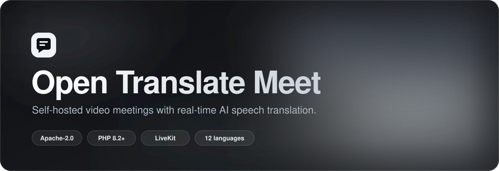
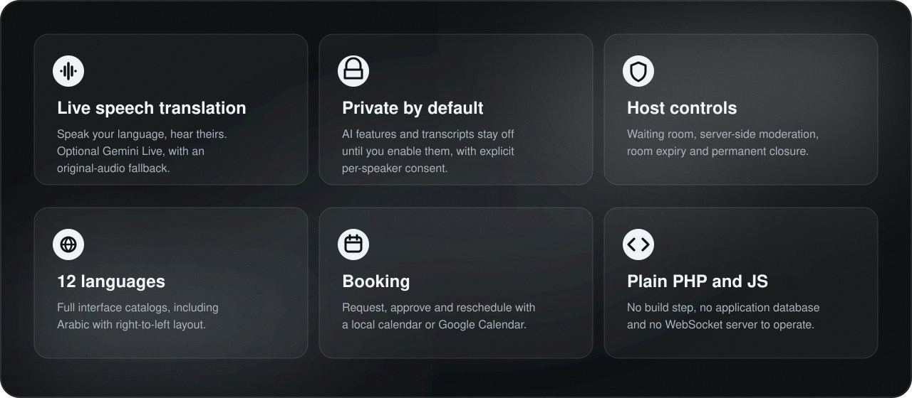
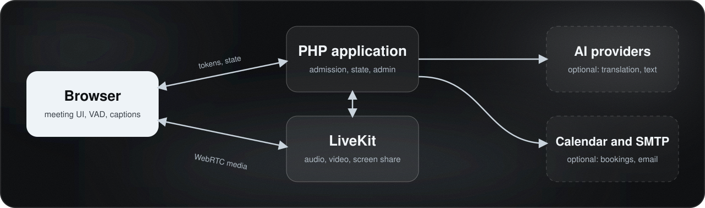

<div align="center">



<br>

[English](README.md) · **Türkçe**

<br>

[](LICENSE)
[](https://github.com/emreocell/Open-Translate-Meet/actions/workflows/quality.yml)
[](composer.json)
[](https://livekit.io)
[](assets/i18n)

[Hızlı başlangıç](#hızlı-başlangıç) · [Özellikler](#özellikler) · [Mimari](#mimari) · [Entegrasyonlar](#entegrasyonlar) · [Dokümantasyon](#dokümantasyon) · [Katkı](#katkı)

</div>

<br>

**Open Translate Meet**, isteğe bağlı gerçek zamanlı konuşma çevirisi sunan, kendi sunucunuzda çalıştırabileceğiniz bir görüntülü toplantı uygulamasıdır. Düz PHP, tarayıcı JavaScript'i ve [LiveKit](https://livekit.io) ile geliştirilmiştir ve bağımsız bir yönetici arayüzü içerir. Özel bir yönetim paneli, uygulamaya ait WebSocket sunucusu veya uygulama veritabanı gerekmez.

Marka, kimlik bilgileri, toplantı politikaları ve veri saklama süreleri sizin kontrolünüzdedir. **Yapay zekâ özellikleri ve kalıcı transkriptler varsayılan olarak kapalıdır.**

<br>

## Özellikler



- **Toplantılar:** görüntü, mikrofon, ekran paylaşımı, cihaz seçimi, sohbet ve boyut sınırlı görsel/video ekleri.
- **Erişim kontrolü:** ayrı katılımcı davetleri ve özel sunucu (host) yetkileri, sunucu tarafında moderasyon, bekleme odası onayı, oda süresi ve kalıcı kapatma.
- **Konuşma çevirisi (isteğe bağlı):** Gemini Live çevirisi, toplantı sırasında konuşma/dinleme dili değiştirme, yeniden bağlanma durumu ve orijinal ses yedeği.
- **Sohbet çevirisi (isteğe bağlı):** Gemini veya OpenAI uyumlu herhangi bir metin uç noktası. Orijinal mesaj her zaman görünür kalır.
- **Transkript ve özetler (isteğe bağlı):** konuşmacı başına açık onay, yapay zekâ özeti için ayrı onay, JSON/metin dışa aktarma ve kanıt bağlantılı taslak özetler.
- **Randevu (isteğe bağlı):** yerel müsaitlik veya Google Takvim ile talep, onay, iptal ve yeniden planlama; yapılandırılabilir SMTP bildirimleri.
- **Yönetim:** oda ve randevu yönetimi, sağlayıcı durumu ve kullanım sayaçları. Tarayıcının bildirdiği ses süresi ve operatör oranlı tahminler, sağlayıcı faturalandırmasından açıkça ayrılır.

<br>

## Mimari



Medyayı LiveKit taşır; katılım onayını ve saklanan durumu PHP uygulaması yönetir. Yapılandırılmış Gemini projesi, çeviri yapan her konuşmacının sesini alır. Metin ve özet sağlayıcıları yalnızca istenen özellik için gereken içeriği alır. Ayrıntılar için [veri akışı ve gizlilik rehberine](docs/PRIVACY.md) bakın.

<br>

## Hızlı başlangıç

**Gereksinimler**

- `curl`, `fileinfo`, `gd`, `mbstring`, `openssl` ve `session` eklentileriyle PHP **8.2+**
- Composer 2
- Gerçek tarayıcı medyası için HTTPS
- LiveKit Cloud veya kendi sunucunuzda LiveKit
- FFmpeg ve FFprobe (yalnızca video ekleri için)

**Kurulum**

```sh
git clone https://github.com/emreocell/Open-Translate-Meet.git
cd Open-Translate-Meet
composer install --no-dev --no-scripts --no-plugins --prefer-dist

export MEET_PRIVATE_DIR=/absolute/path/outside-the-web-root/meeting-private
php bin/init-config.php
```

Oluşturulan özel `.env` dosyasını düzenleyip `APP_URL`, `LIVEKIT_URL`, `LIVEKIT_API_KEY` ve `LIVEKIT_API_SECRET` değerlerini girin. `APP_SECRET` zaten üretilmiştir; bir sağlayıcı anahtarıyla değiştirmeyin. Aynı `MEET_PRIVATE_DIR` değerini PHP-FPM, Apache veya konteyner ortamında da tanımlayın.

**Yerelde çalıştırma**

```sh
php bin/set-admin.php
php bin/check-config.php
php -S localhost:8080 -t . deploy/dev-router.php
```

**http://localhost:8080/admin/** adresini açın, giriş yapın, bir oda oluşturun ve **katılımcı** bağlantısını paylaşın. Özel host bağlantısı toplantı kontrolü verir, bu yüzden kimseyle paylaşmayın.

> [!NOTE]
> PHP geliştirme sunucusu yalnızca yerel duman testleri içindir. Gerçek kullanıcılar için hazır Apache veya Nginx yapılandırmasını ya da [barındırma rehberindeki](docs/SELF_HOSTING.md) Docker kurulumunu kullanın. LiveKit'in imzalı webhook adresini `APP_URL/api/livekit-webhook.php` olarak ayarlayın. Kendi sunucunuzdaki LiveKit için ayrıca `room.auto_create: false` olmalıdır.

<br>

## Entegrasyonlar

Yalnızca ihtiyacınız olanları etkinleştirin.

| Özellik | Yapılandırma | Dış gereksinim |
| :--- | :--- | :--- |
| Temel toplantılar | `LIVEKIT_URL`, anahtar, gizli anahtar | LiveKit Cloud hesabı veya kendi sunucunuz |
| Konuşma çevirisi | `TRANSLATION_PROVIDER=gemini`, açık `GEMINI_MODEL`, API anahtarı | Live çeviri ve geçici kimlik bilgisi destekleyen bir model |
| Sohbet çevirisi ve özetler | `TEXT_PROVIDER`, `TEXT_MODEL`, `TEXT_API_KEY` | Bir metin üretim API'si (OpenAI uyumlu uç noktalar desteklenir) |
| Kalıcı transkript | `TRANSCRIPT_ENABLED=true`, host kaydı açar, konuşmacılar onay verir | Canlı altyazı |
| Randevu | `BOOKING_ENABLED=true` | Varsayılan olarak yerel takvim; seçilirse Google OAuth |
| Bildirimler | SMTP ayarları ve sahip e-postası | Bir SMTP hesabı |

Hiçbir model sessizce seçilmez. Model kimlikleri, desteklenen diller, kota ve erişilebilirlik zamanla değişir; hesabınızın desteklediği bir modeli sağlayıcının güncel dokümantasyonuna göre seçin. Sağlayıcı kotası ve faturalandırması geçerlidir. Çeviri sağlayıcısı yapılandırılmamışsa normal toplantılar tamamen kullanılabilir kalır. Bu, çevrimdışı bir çeviri motoru değildir.

<br>

## Proje yapısı

| Yol | Amaç |
| :--- | :--- |
| `api/` | Kimlik doğrulama, oda durumu, sağlayıcı bağdaştırıcıları, randevu, transkript, ekler |
| `assets/js/` | Tarayıcıda toplantı, çeviri, sohbet, yönetim ve erişilebilirlik davranışı |
| `assets/i18n/` | 12 dilde arayüz katalogları |
| `admin/` | Bağımsız yönetici arayüzü |
| `privacy/`, `randevu/` | Gizlilik bilgisi ve bağımsız randevu sayfası |
| `bin/` | Yerel yapılandırma ve yönetici komutları |
| `deploy/` | Apache, Nginx, PHP ve geliştirme sunucusu örnekleri |
| `tests/` | Regresyon testleri ve yalıtılmış protokol entegrasyon testleri |
| `LICENSES/` | Üçüncü taraf lisans metinleri ve bildirimleri |

<br>

## Doğrulama

```sh
npm ci --ignore-scripts
npm run vendor:verify
npm test
php tests/backend_security.php
php tests/portability.php
php tests/root_security_review.php
php tests/bookings.php
php tests/bookings.php google
python3 tests/integration_backend.py
composer audit
npm audit --omit=dev
```

Node 22+ yalnızca geliştirme aracıdır; yayınlanan uygulama, derleme adımı olmadan depodaki tarayıcı dosyalarını sunar. CI ayrıca PHP/JS sözdizimini, bağımlılık bildirimlerini, sırları, tarayıcı fixture'larını ve konteyner imajını denetler.

> [!IMPORTANT]
> Yalıtılmış entegrasyon testleri sağlayıcı protokollerini taklit eder. Gerçek mikrofon, WebRTC, Gemini, Google veya SMTP davranışını **kanıtlamazlar**. Canlı kabul kontrolleri için [test rehberine](docs/TESTING.md) bakın.

<br>

## Kapsam ve sınırlar

- Varsayılan kapasite sekiz katılımcıdır. Artırmak bir dağıtım üst sınırını değiştirir; medya kapasitesini veya sağlayıcı kotasını göstermez.
- Dosya deposu dosya sistemi kilitlerini kullanır ve tek bir uygulama sunucusunu hedefler; koordine edilmeyen kopyaları veya sonunda tutarlı ağ dosya sistemlerini hedeflemez.
- Anonim cihaz yasakları, tarayıcı depolaması temizlenerek veya cihaz değiştirilerek aşılabilir. Kimlik önemliyse parola ve host onayı kullanın. [Güvenlik modeline](docs/SECURITY_MODEL.md) bakın.
- Hedef tarayıcılar güncel masaüstü Chrome, Edge, Firefox ve Safari'dir. Cihaz seçimi, sistem sesi paylaşımı ve otomatik oynatma tarayıcılar arasında farklılık gösterir; mobil tarayıcılar arka planda medyayı askıya alabilir.

<br>

## Dokümantasyon

Dokümanlar İngilizce yazılmıştır.

| Rehber | Açıklama |
| :--- | :--- |
| [Self-hosting](docs/SELF_HOSTING.md) | Docker ve üretim kurulumu |
| [Configuration](docs/CONFIGURATION.md) | Tüm ayarlar ve varsayılanlar |
| [Privacy](docs/PRIVACY.md) | Veri akışları ve saklama |
| [Security model](docs/SECURITY_MODEL.md) | Tehdit modeli ve kalan sınırlar |
| [Integration API](docs/INTEGRATION-API.md) | İmzalı sunucudan sunucuya yönetim API'si |
| [Testing](docs/TESTING.md) | Otomatik testler ve canlı kabul kontrolleri |
| [Release checklist](docs/RELEASE.md) | Sürüm hazırlığı |

<br>

## Katkı

Katkılarınızı bekliyoruz. Önce [CONTRIBUTING.md](CONTRIBUTING.md) dosyasını okuyun; güvenlik açıklarını [SECURITY.md](SECURITY.md) dosyasında anlatıldığı gibi özel olarak bildirin.

## Lisans

[Apache License 2.0](LICENSE) ile lisanslanmıştır; kişisel ve ticari kullanıma, değiştirmeye ve yeniden dağıtıma izin verir. Atıf ve üçüncü taraf lisansları için [NOTICE](NOTICE) ve [THIRD_PARTY_NOTICES.md](THIRD_PARTY_NOTICES.md) dosyalarına bakın. Şirket ve sağlayıcı ticari markaları kendi sahiplerine aittir.

<div align="center">
<br>
<sub><a href="https://github.com/emreocell">Emre Öcel</a> tarafından geliştirildi</sub>
</div>
